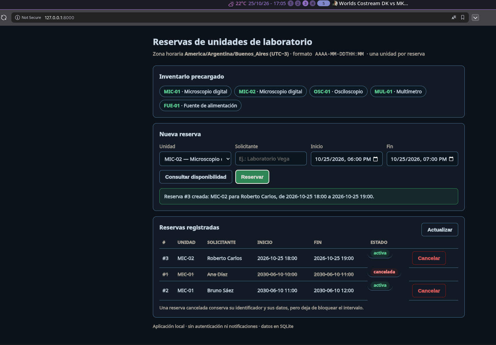

# Registro de decisiones y delegación

Documento versionado: decisiones técnicas significativas y los **tres episodios
reales de delegación** con el agente. Cada afirmación enlaza con un commit, una
prueba o una salida de comando reproducible; lo que no se ejecutó se declara
como tal.

---

## 1. Decisiones significativas

| # | Decisión | Alternativa descartada | Motivo | Consecuencia |
| - | -------- | ---------------------- | ------ | ------------ |
| D1 | Python 3.14 + **pytest** | Node + Vitest; Python stdlib `unittest` | El usuario eligió Python + pytest en la consulta previa al desarrollo; pytest da mensajes de fallo útiles sin añadir dependencias de runtime | `pytest` es la **única** dependencia de desarrollo; el código usa sólo biblioteca estándar |
| D2 | **SQLite** (`data/reservas.db`) | JSON plano | El usuario eligió SQLite; permite transacciones, índice por unidad y el chequeo atómico de superposición | `src/reservas/persistencia.py` concentra todo el acceso a datos; reiniciar no borra nada (esquema `IF NOT EXISTS`) |
| D3 | **Frontend HTML** + API JSON local | CLI (recomendada por el agente), o "CLI + API" | **Decisión explícita del usuario**: al proponer las tres opciones respondió *"make a simple frontend using html"* | `src/reservas/api.py` (servidor stdlib) + `static/`; 14 pruebas de punta a punta |
| D4 | **Un único predicado** de superposición en `dominio.hay_superposicion()` | Repetir la comparación en SQL y en Python | `AGENTS.md` §1.3 lo prohíbe expresamente; dos lugares = dos versiones de la regla | `tests/test_dominio.py::test_el_predicado_vive_en_un_solo_lugar` falla si se duplica |
| D5 | Entradas ISO sin offset → zona `America/Argentina/Buenos_Aires`; **almacenaje en instante UTC** (epoch) | Guardar el texto tal cual; guardar hora local naive | Evita ambigüedad y permite comparar intervalos sin errores de zona | Supuestos A1–A2 del README; las respuestas incluyen offset `-03:00` |
| D6 | **Rechazar** reservas cuyo inicio está en el pasado, con **reloj inyectable** | Permitir fechas pasadas para simplificar | Una coordinación no debería reservar "para ayer"; el reloj inyectable hace determinísticos los tests | `RESERVA_EN_PASADO` (R7); `servicio.ahora` es un parámetro de test |
| D7 | Cancelar dos veces → error `YA_CANCELADA` (HTTP 409) | Cancelación idempotente (200 siempre) | La consigna pide cancelar *conservando* datos; un segundo intento es un error de operación conviene verlo | `test_cancelar_dos_veces_es_error`, `test_cancelar_dos_veces_responde_409` |
| D8 | Escrituras **serializadas** (bloqueo + `BEGIN IMMEDIATE`) | Dejar el chequeo en una consulta separada del `INSERT` | Dos escrituras simultáneas podrían pasar el mismo chequeo; la concurrencia distribuida está fuera de alcance | `persistencia.Repositorio._bloqueo` |
| D9 | Servidor HTTP de la **biblioteca estándar** | FastAPI / Flask | Reproducir sin red ni cuentas del autor; menos dependencias que justificar | `python -m reservas` arranca en `127.0.0.1:8000` |
| D10 | `data/` **ignorado por Git** | Versionar la base de datos | La base es regenerable y contiene datos de uso, no de ejemplo | Advertencia en README §2: borrar `data/` **sí** borra las reservas |
| D11 | Solicitantes y personas: **siempre ficticios** | — | Exigido por la consigna | `Ana Díaz`, `Bruno Sáez`, `Carla Nuñez` en pruebas y evidencia |

---

## 2. Los tres episodios de delegación

### Episodio 1 — De la consigna al núcleo de reglas

| Campo | Contenido |
| ----- | --------- |
| **Objetivo y requisito** | Traducir las reglas de la consigna (superposición, límites consecutivos, validaciones, cancelación con historial, persistencia al reiniciar) en código con pruebas automáticas. |
| **Contexto suministrado** | Texto de `docs/challenge-agents.pdf`, extraído con `pdftotext -layout challenge-agents.pdf` (135 líneas; el PDF estaba en la raíz al inicio del trabajo) — el modelo no admite PDF como entrada, por eso se extrajo en lugar de leerlo directamente — más `AGENTS.md`, `inventario.json` y el README de especificación. Se excluyó todo lo ajeno al repositorio (no había sesiones previas: el repo estaba sin commits). |
| **Extracto de instrucción** | `AGENTS.md` §1.1: *"Límites consecutivos no son superposición: dos reservas activas de la misma unidad donde `fin(A) == inicio(B)` son ambas válidas"* y §1.3: *"el predicado vive en `reservas.dominio.hay_superposicion()` y ambas rutas lo usan"*. |
| **Acción del agente** | Escribió `dominio.py` (validaciones, fechas, predicado único), `persistencia.py` (SQLite con chequeo atómico) y `servicio.py` (orden de validaciones), con 32 pruebas de reglas, 31 de dominio y 5 de persistencia. |
| **Decisión humana** | **Aceptar**, con dos precisiones del propio usuario antes de empezar: stack *Python + pytest* y persistencia *SQLite*. Motivo: reproducibilidad sin la cuenta del modelo. |
| **Evidencia** | Commits `76523c5` (especificación) y el bloque `21823aa` → `ed6bf10` (dominio, persistencia, servicio y sus pruebas); `tests/test_reglas.py`, `tests/test_dominio.py`, `tests/test_persistencia.py`; salida en [`evidencia/pytest.txt`](evidencia/pytest.txt). |

### Episodio 2 — Interfaz: de la CLI recomendada a un frontend HTML

| Campo | Contenido |
| ----- | --------- |
| **Objetivo y requisito** | Elegir la interfaz de la aplicación (la consigna admite consola o API local; prohíbe el frente gráfico complejo). |
| **Contexto suministrado** | Pregunta del agente con tres opciones y su recomendación (CLI por ser la más simple de probar). |
| **Acción del agente** | Implementó servidor HTTP stdlib con API JSON (`/api/inventario`, `/api/disponibilidad`, `/api/reservas`, `/api/reservas/<id>/cancelar`) y una página única HTML + CSS + JS sin CDN, con consulta de disponibilidad, alta, listado y cancelación. |
| **Decisión humana** | **Aceptar la opción contraria a la recomendación**: el usuario respondió *"make a simple frontend using html"*. Motivo: quería ver la aplicación en el navegador. Consecuencia asumida: más código y más pruebas que una CLI. |
| **Evidencia** | Commits `812c377` (frontend) y `61ebcaa` (pruebas HTTP) — `git show 812c377` —; `tests/test_api.py` (14 pruebas); recorrido HTTP completo con códigos en [`evidencia/smoke-http.txt`](evidencia/smoke-http.txt); página servida en `GET /` (`test_pagina_principal`). |

*Captura real de la página servida por `python -m reservas` (`docs/frontend-view.png`).*

### Episodio 3 — Corrección de una prueba incorrecta durante la verificación

| Campo | Contenido |
| ----- | --------- |
| **Objetivo y requisito** | Dejar la suite en verde antes de commitear (obligación de `AGENTS.md` §3). |
| **Contexto suministrado** | Salida de la primera corrida: `81 passed, 1 failed`, con el fallo en `test_unidades_distintas_pueden_reservar_el_mismo_intervalo`. |
| **Acción del agente** | Diagnosticó que **el código estaba bien y la afirmación estaba mal**: la prueba reservaba MIC-02 de 10:00 a 11:00 y después afirmaba que MIC-02 seguía *disponible* en ese mismo intervalo. Corrigió la prueba —no la implementación— para afirmar lo que la consigna realmente exige: que MIC-02 **puede reservarse** con MIC-01 ocupado, que su disponibilidad es independiente y que el límite consecutivo a las 11:00 sigue libre. |
| **Decisión humana** | El usuario fue consultado para revisar; **interrumpió la consulta y respondió «continue where i accidentaly interrupted»**, es decir, delegó la continuación. La corrección quedó aceptada tácitamente y queda verificada por la suite en verde. **No ocurrió ninguna corrección posterior ni rechazo.** |
| **Evidencia** | Diagnóstico reproducible en [`evidencia/diagnostico-correccion.txt`](evidencia/diagnostico-correccion.txt) con su script [`diagnostico_correccion.py`](evidencia/diagnostico_correccion.py); la afirmación corregida está en `tests/test_reglas.py::test_unidades_distintas_pueden_reservar_el_mismo_intervalo`; commit `f720791`. |

> **Nota de honestidad:** la salida de la corrida que falló ocurrió *antes* del
> commit `f720791` y **no quedó versionada** (sólo existía en la terminal de la
> sesión). En su lugar se conserva el diagnóstico reproducible, que muestra el
> valor real de la afirmación que estaba mal. No se inventa ninguna otra falla
> ni se adjunta la transcripción completa de la conversación.

---

## 3. Informado por el agente vs. realmente ejecutado

| Afirmación | Estado | Evidencia |
| ---------- | ------ | --------- |
| 82 pruebas automatizadas en verde | **Ejecutado** | `docs/evidencia/pytest.txt` (corrida `-vv` completa) |
| API responde los códigos esperados (201/409/400/404) | **Ejecutado** | `docs/evidencia/smoke-http.txt`, etapas 4–10 |
| Los datos sobreviven a detener y arrancar de nuevo | **Ejecutado** | Etapas 12–14 de `smoke-http.txt` (kill + proceso nuevo) y `test_persistencia_entre_procesos_distintos` |
| El frontend carga y muestra el inventario | **Ejecutado** | `GET /` y `GET /static/app.js` en `tests/test_api.py::test_pagina_principal` y `::test_javascript_y_css` |
| Prueba manual en navegador con clics | **No ejecutado** | La verificación automatizada cubre la API y los assets; el recorrido con el navegador queda para la revisión humana (limitación declarada en README §2) |
| Versiones de Python, pytest, SQLite, OpenCode | **Ejecutado** | `docs/preparacion-del-agente.md` §1 (comandos citados) |
| `AGENTS.md` fue inyectado como instrucción de la sesión | **Ejecutado** | El harness lo carga automáticamente desde la raíz del repositorio; el archivo está commiteado en `f267201` |

---

## 4. Pendientes y limitaciones conocidas

1. No hay prueba automatizada que simule el clic en el navegador (la API sí está cubierta de punta a punta).
2. No se aplican límites de duración ni de anticipación (supuestos A4); si la coordinación los necesita, hay que agregarlos y cubrirlos con pruebas.
3. No hay autenticación ni roles: el servidor queda en `127.0.0.1` (fuera de alcance por la consigna).
4. No se contempla concurrencia distribuida: un solo proceso con varias conexiones y bloqueo de escritura.
